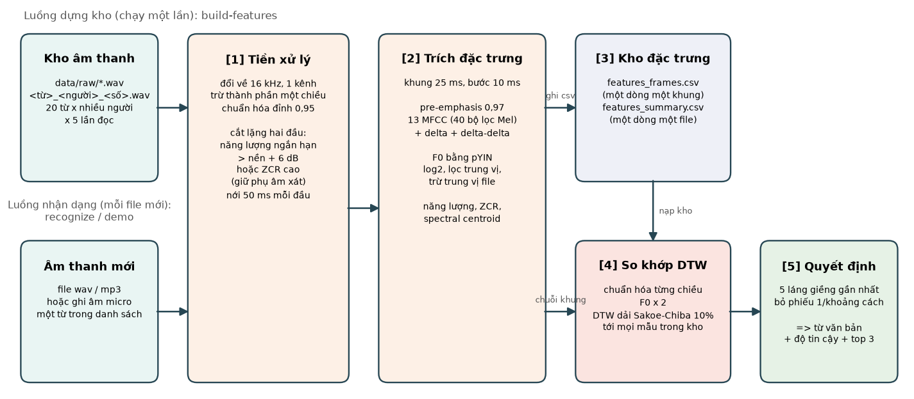

# Speech-to-Text từ đơn lẻ tiếng Việt

Hệ thống nhận dạng từ đơn lẻ tiếng Việt: đầu vào là một file âm thanh chứa một từ trong danh sách 20 từ, đầu ra là từ đó dạng văn bản. Phương pháp chính là MFCC kết hợp cao độ F0, so khớp DTW với kho mẫu và bỏ phiếu k láng giềng gần nhất. Kèm bộ sinh dữ liệu mẫu, công cụ thu âm, đánh giá hai kịch bản người đã có và giọng mới, so sánh với SVM và Random Forest, và giao diện demo trên trình duyệt.



## Cài đặt nhanh

Cần Python 3.11 đến 3.13. Hướng dẫn cài từng bước cho Windows, macOS, Linux và cách xử lý lỗi ở **[HUONG-DAN.md mục 2](HUONG-DAN.md#2-cài-đặt-chi-tiết)**.

**Windows (PowerShell):**

```powershell
git clone https://github.com/giabaohb99/speech_to_text.git
cd speech_to_text
python -m venv .venv
.venv\Scripts\python -m pip install -r requirements.txt
.venv\Scripts\python stt.py recognize data/raw/mot_tts_f1_p2_03.wav
```

**macOS, Linux:**

```bash
git clone https://github.com/giabaohb99/speech_to_text.git
cd speech_to_text
python3 -m venv .venv
.venv/bin/python -m pip install -r requirements.txt
.venv/bin/python stt.py recognize data/raw/mot_tts_f1_p2_03.wav
```

Lệnh cuối in `Từ nhận dạng: một`. Dữ liệu mẫu và kho đặc trưng đã có sẵn trong kho mã, không cần sinh lại.

## Các lệnh chính

Viết gọn `python` cho Python trong môi trường ảo (`.venv\Scripts\python` trên Windows, `.venv/bin/python` trên macOS, Linux).

| Lệnh | Làm gì |
|---|---|
| `python stt.py demo` | Mở giao diện trên trình duyệt: ghi âm micro, tải file, hoặc chọn file mẫu |
| `python stt.py recognize FILE` | Nhận dạng một file, lưu hình kết quả vào `results/recognize/` |
| `python stt.py evaluate` | Đánh giá hai kịch bản, bốn phương pháp, khoảng 2,5 phút |
| `python stt.py record --speaker an` | Thu âm giọng thật cho một thành viên |
| `python stt.py build-features` | Dựng lại kho đặc trưng sau khi thêm dữ liệu |
| `python stt.py gen-data` | Sinh lại dữ liệu mẫu bằng edge-tts |
| `python stt.py plot` | Vẽ hình minh họa đặc trưng và sơ đồ khối |
| `python stt.py --help` | Xem mọi lệnh |

## Kết quả trên dữ liệu mẫu

Dữ liệu mẫu sinh tự động: 20 từ, 10 giọng biến thể từ 2 giọng gốc, 1000 file.

| Phương pháp | Người đã có | Giọng mới |
|---|---|---|
| DTW + F0 | 99,3% | 50,9% |
| DTW không F0 | 99,5% | 48,7% |
| SVM | 99,1% | 44,0% |
| Random Forest | 98,7% | 46,8% |

Kịch bản giọng mới thấp vì dữ liệu mẫu chỉ có hai giọng gốc khác giới. Nhận xét chi tiết ở [results/README.md](results/README.md). Cần chạy lại trên thu âm thật của nhóm.

## Tài liệu

- [HUONG-DAN.md](HUONG-DAN.md): cài đặt chi tiết, các lệnh, giao diện, quy trình thu âm thật, lỗi thường gặp.
- [01. Tóm tắt bài toán](doc/01-tom-tat-bai-toan.md): phát biểu bài toán, sơ đồ khối, phạm vi, rủi ro.
- [02. Danh sách công việc](doc/02-danh-sach-cong-viec.md): 8 phase từ khởi tạo tới đóng gói, nghiệm thu từng phase.
- [03. Tài liệu kỹ thuật](doc/03-tai-lieu-ky-thuat.md): kiến trúc, quy ước dữ liệu, tiền xử lý, lược đồ csv, DTW, đánh giá.
- [04. Đối chiếu đề bài](doc/04-doi-chieu-de-bai.md): từng mục trong 7 mục của đề được đáp ứng ở đâu.
- [05. Cơ sở lý thuyết](doc/05-co-so-ly-thuyet.md): kỹ thuật nhận dạng, đặc trưng âm thanh và cách trích, lưu trữ và so khớp.
- [Nguồn gốc dữ liệu](data/README.md), [Kết quả và nhận xét](results/README.md)
